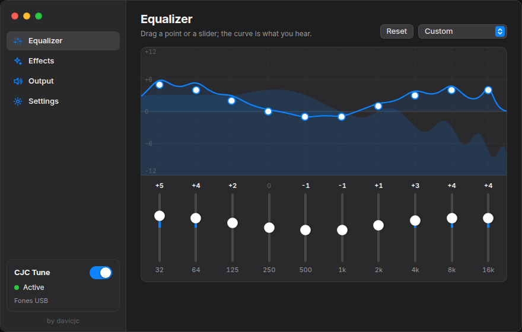

<p align="center">
  
</p>

<h1 align="center">CJC Tune</h1>

<p align="center">A system-wide equalizer and sound effects for Linux, made to feel like a Mac app.<br><sub>by <a href="https://davicjc.com">davicjc</a></sub></p>

<p align="center">
  
  
  
  
  
  
</p>

<p align="center"><a href="https://tune.cjc.pics/en/"><strong>tune.cjc.pics</strong></a></p>

<p align="center"><a href="README.md">Português</a> · <strong>English</strong></p>

<p align="center">
  
</p>

CJC Tune adds an audio output called **CJC Tune**, makes it the default and processes everything
your apps play: a 10-band equalizer, fidelity, ambience, dynamic boost, 3D surround and
HyperBass. The result goes to your headphones or speakers exactly once, with no echo.

## Features

| | |
|---|---|
| **Graphical EQ** | The curve on screen is the real response of the ten filters, computed with the same math as the processor. Drag the points or use the sliders below; the live spectrum sits behind it |
| **Effects** | Fidelity, Ambience, Dynamic boost, 3D surround and HyperBass, with 10 presets |
| **Restart audio service** | In the tray and on the Output page. Recreates the device and clears the filters without closing anything, for crackling, stuck or missing sound. `pkill -USR2 cjc-tune` does the same, so it can go on a keyboard shortcut |
| **Output** | Lists the devices, shows which one is in use, and follows whatever you plug in when set to Automatic |
| **Tray** | Closing the window keeps the sound processed. Show, hide, effects on/off, restart and quit from the icon |
| **Appearance** | Light, dark or automatic theme and 8 accent colors, as on macOS |
| **Open at login** | Optionally hidden in the tray. Works with the AppImage |
| **Updates** | When a new version is published on GitHub, **Update** shows in the sidebar. The AppImage downloads it, checks the SHA-256 GitHub publishes, swaps the file and reopens; the `.deb` opens the release page. This is the only thing that goes online, and it can be turned off |
| **Export and import** | The configuration as JSON. Files exported by FXSound for Linux import too |
| **Light on resources** | The window is drawn by the GPU where that is safe, and the spectrum stops completely when the window is hidden or another page is open |
| **4 languages** | Portuguese, English, Spanish and Chinese, in the window and the tray menu |

<p align="center">
  
</p>

## Install

Get the AppImage or the `.deb` from the [releases page](https://github.com/Davicjc/cjc-tune/releases/latest).

**AppImage** (no install needed):

```bash
chmod +x cjc-tune_1.0.0_amd64.AppImage
./cjc-tune_1.0.0_amd64.AppImage
```

**.deb** (Debian, Ubuntu, Linux Mint):

```bash
sudo apt install ./cjc-tune_1.0.0_amd64.deb
```

If you used FXSound for Linux, quit it first. On its first launch CJC Tune brings over your EQ,
effects and output from it.

## Build

```bash
sudo apt install -y build-essential pkg-config libssl-dev file \
  libwebkit2gtk-4.1-dev libgtk-3-dev librsvg2-dev libpulse-dev libayatana-appindicator3-dev
curl --proto '=https' --tlsv1.2 -sSf https://sh.rustup.rs | sh   # Rust
# Node.js 20 or newer

git clone https://github.com/Davicjc/cjc-tune.git
cd cjc-tune
npm ci
npm run tauri build -- --bundles appimage,deb
```

Packages land in `src-tauri/target/release/bundle/`. For development: `npm run tauri dev`.

## How it works

```text
apps ──▶ "CJC Tune" output ──monitor──▶ processor (dsp/) ──▶ headphones / speakers
```

| Path | What is there |
|---|---|
| `src-tauri/src/dsp/` | Processing: `biquad.rs` (filters that glide between settings without clicks), `reverb.rs`, `dynamics.rs` (compressor and limiter), `chain.rs` (the full chain and the spectrum) |
| `src-tauri/src/routing.rs` | Talks to PipeWire/PulseAudio: creates the device, picks the output, recovers when the server goes away, restarts on request |
| `src-tauri/src/tray.rs` | Tray icon and menu |
| `src-tauri/src/commands.rs` | What the window may ask the Rust side |
| `src-tauri/src/settings.rs` | Saved settings, export/import and the FXSound for Linux migration |
| `src/` | The React window: `components/` (sidebar, EQ graph, pages), `ui/` (macOS-style controls), `lib/` (presets and EQ math) |

Tests: `cargo test` (46 tests for the processor, settings and routing) and
`tests/audio-routing/verify.sh`, which starts a real PipeWire or PulseAudio with fake sound
cards and checks that sound arrives exactly once, that the app follows plugged-in headphones,
recovers when the server dies and plays again after a service restart. Runs on GitHub Actions.

## Limitations

- Fixed 48 kHz stereo.
- On Wayland and with the NVIDIA driver the window is drawn by the CPU (safe mode). The sound is the same.
- The tray needs a desktop with StatusNotifier (Cinnamon, KDE, XFCE, GNOME with an extension).

## Credits

CJC Tune grew out of [FXSound for Linux](https://github.com/Raul909/FXSound_For_Linux) 1.2.0, by
Raul909 and contributors, under the MIT license. The audio processing and routing come from
there; the interface, the code layout, the service restart and the migration are this
project's. The original copyright notice is kept in [LICENSE](LICENSE).

**by [davicjc](https://davicjc.com)** · Davi Castro
