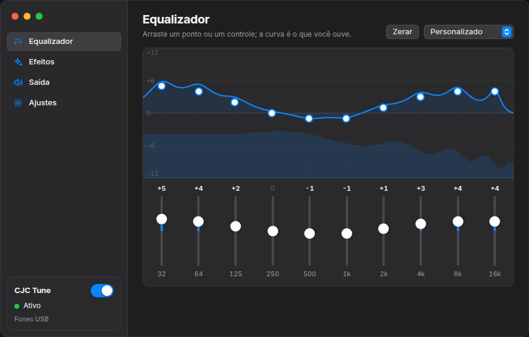

<p align="center">
  
</p>

<h1 align="center">CJC Tune</h1>

<p align="center">Equalizador e efeitos de som para o Linux inteiro, com cara de app de Mac.<br><sub>by <a href="https://davicjc.com">davicjc</a></sub></p>

<p align="center">
  
  
  
  
  
  
</p>

<p align="center"><strong>Português</strong> · <a href="README.en.md">English</a></p>

<p align="center">
  
</p>

O CJC Tune cria uma saída de áudio chamada **CJC Tune**, coloca ela como padrão e processa tudo o
que os programas tocam: equalizador de 10 bandas, fidelidade, ambiente, reforço dinâmico,
surround 3D e HyperBass. O resultado vai para o seu fone ou caixa de som, uma vez só, sem eco.

## O que tem

| | |
|---|---|
| **Equalizador em gráfico** | A curva na tela é a resposta real dos 10 filtros, calculada com a mesma fórmula do processador. Arraste os pontos ou use os controles embaixo; o espectro ao vivo fica por trás |
| **Efeitos** | Fidelidade, Ambiente, Reforço dinâmico, Surround 3D e HyperBass, com 10 predefinições |
| **Reiniciar serviço de áudio** | Na bandeja e na tela Saída. Recria o dispositivo e zera os filtros sem fechar nada: resolve som estalando, travado ou sumido. `pkill -USR2 cjc-tune` faz o mesmo, então dá para pôr num atalho de teclado |
| **Saída** | Lista os dispositivos, mostra qual está em uso e segue o aparelho que você conectar no modo Automático |
| **Bandeja** | Fechar a janela deixa o som processado rodando. Mostrar, esconder, ligar/desligar efeitos, reiniciar e sair pelo ícone |
| **Aparência** | Tema claro, escuro ou automático e 8 cores de destaque, como no macOS |
| **Iniciar com o sistema** | Com a opção de já começar escondido na bandeja. Funciona com o AppImage |
| **Exportar e importar** | A configuração em JSON. Também lê arquivos exportados pelo FXSound for Linux |
| **Leve** | A janela é desenhada pela placa de vídeo onde isso é seguro, e o espectro para por completo com a janela escondida ou fora da tela do equalizador |
| **4 idiomas** | Português, inglês, espanhol e chinês, na janela e no menu da bandeja |

<p align="center">
  
</p>

## Instalar

Baixe o AppImage ou o `.deb` na [página de releases](https://github.com/Davicjc/cjc-tune/releases/latest).

**AppImage** (roda sem instalar):

```bash
chmod +x cjc-tune_1.0.0_amd64.AppImage
./cjc-tune_1.0.0_amd64.AppImage
```

**.deb** (Debian, Ubuntu, Linux Mint):

```bash
sudo apt install ./cjc-tune_1.0.0_amd64.deb
```

Se você usava o FXSound for Linux, feche ele antes. Na primeira vez, o CJC Tune traz o seu EQ, os
efeitos e a saída que estavam lá.

## Compilar

```bash
sudo apt install -y build-essential pkg-config libssl-dev file \
  libwebkit2gtk-4.1-dev libgtk-3-dev librsvg2-dev libpulse-dev libayatana-appindicator3-dev
curl --proto '=https' --tlsv1.2 -sSf https://sh.rustup.rs | sh   # Rust
# Node.js 20 ou mais novo

git clone https://github.com/Davicjc/cjc-tune.git
cd cjc-tune
npm ci
npm run tauri build -- --bundles appimage,deb
```

Os pacotes saem em `src-tauri/target/release/bundle/`. Para desenvolver: `npm run tauri dev`.

## Como funciona

```text
programas ──▶ saída "CJC Tune" ──monitor──▶ processador (dsp/) ──▶ fone / caixa de som
```

| Pasta | O que tem |
|---|---|
| `src-tauri/src/dsp/` | Processamento: `biquad.rs` (filtros que deslizam entre ajustes, sem estalo), `reverb.rs`, `dynamics.rs` (compressor e limitador), `chain.rs` (a cadeia completa e o espectro) |
| `src-tauri/src/routing.rs` | Conversa com o PipeWire/PulseAudio: cria o dispositivo, escolhe a saída, se recupera quando o servidor cai, e reinicia sob pedido |
| `src-tauri/src/tray.rs` | Ícone e menu da bandeja |
| `src-tauri/src/commands.rs` | O que a janela pode pedir ao Rust |
| `src-tauri/src/settings.rs` | Configuração salva, exportar/importar e a migração do FXSound for Linux |
| `src/` | A janela em React: `components/` (barra lateral, gráfico do EQ, telas), `ui/` (controles no estilo macOS), `lib/` (presets e a matemática do EQ) |

Testes: `cargo test` (46 testes do processador, da configuração e do roteamento) e
`tests/audio-routing/verify.sh`, que sobe PipeWire ou PulseAudio de verdade com placas de som
falsas e confere que o som chega uma vez só, que o app segue o fone conectado, que se recupera
quando o servidor cai e que o reinício do serviço volta tocando. Roda no GitHub Actions.

## Limitações

- Taxa fixa de 48 kHz, estéreo.
- No Wayland e com driver NVIDIA a janela é desenhada pelo processador (modo seguro). O som não muda.
- A bandeja precisa de um desktop com StatusNotifier (Cinnamon, KDE, XFCE, GNOME com extensão).

## Créditos

O CJC Tune nasceu do [FXSound for Linux](https://github.com/Raul909/FXSound_For_Linux) 1.2.0, de
Raul909 e colaboradores, sob licença MIT. O processamento e o roteamento de áudio vêm de lá; a
interface, a organização do código, o reinício do serviço e a migração são deste projeto. O
aviso de copyright original está mantido no [LICENSE](LICENSE).

**by [davicjc](https://davicjc.com)** · Davi Castro
